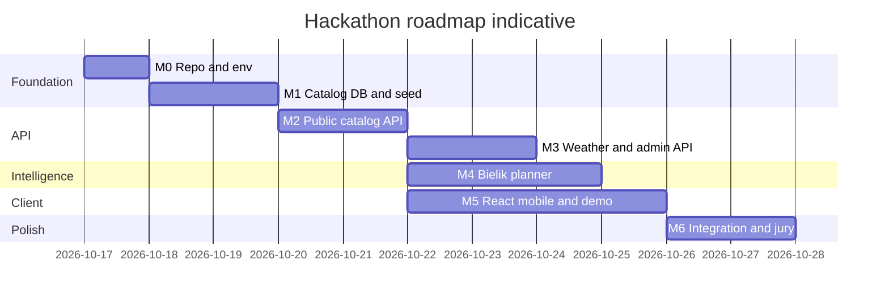
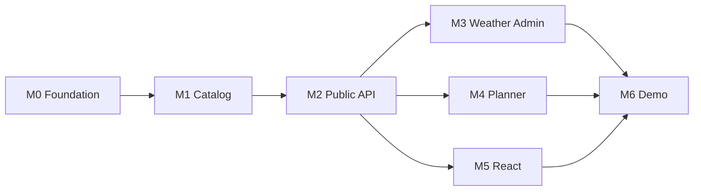

# Master plan — implementation and roadmap

> **For implementers:** Follow phases in order unless parallel workstreams are staffed. Specs live in [design/](design/); alignment with product brief in [SCOPE-ALIGNMENT.md](SCOPE-ALIGNMENT.md).

**Goal:** Deliver a hackathon demo: mobile React app + FastAPI backend + SQLite catalog + Bielik planner (home server) + weather-aware plans for Sierpc/Gostynin area.

**Architecture:** Split **backend** (this repo) and **frontend** (React TS PWA). Backend orchestrates catalog filters, weather proxy, and OpenAI-compatible calls to **remote Bielik**. Client holds user persona/preferences locally; displays **PlanEnrichedResponse** with catalog-hydrated map data.

**Tech stack:** Python 3.13, Tortoise ORM, SQLite, FastAPI, Uvicorn, httpx; React, TypeScript, Vite; Bielik via Ollama/vLLM/compatible API; weather provider adapter (stub → Open-Meteo or custom).

## Global constraints

- English API/DB field names; Polish user-facing copy from LLM and seed data.
- No login, registration, or server-side user tables.
- MVP catalog: `Place`, `OpeningHours`, `PredefinedRoute`, `RouteStop` only.
- Planner: orchestrator + candidate injection (not multi-turn tools) per [llm-bielik-integration-design.md](design/llm-bielik-integration-design.md).
- Admin via `/api/v1/admin/*` + React admin routes; `ADMIN_ENABLED` for deploy.

---

## Roadmap overview



Phases can overlap: **frontend** can start against OpenAPI mock after M2; **Bielik** home server can be prepared in parallel with M1.

---

## Milestones

### M0 — Foundation (day 0–1)

| Deliverable | Owner | Details |
|-------------|-------|---------|
| Backend deps | Backend | Add FastAPI, uvicorn, pydantic-settings, httpx to `pyproject.toml` |
| App skeleton | Backend | `api/app.py`, lifespan Tortoise init (replace or wrap thread `Database` if needed) |
| Frontend repo | Frontend | Vite React TS, `VITE_API_BASE_URL`, mobile viewport |
| Env templates | Both | `.env.example`: CORS, LLM_*, WEATHER_*, ADMIN_ENABLED (backend); `VITE_API_BASE_URL` (frontend) |

**Exit:** `GET /health` returns OK; frontend dev server runs and can reach the API (health banner on home screen).

---

### M1 — Catalog database (day 1–3)

| Deliverable | Details |
|-------------|---------|
| Tortoise models | Per [catalog-db-design.md](design/catalog-db-design.md) |
| Migrations | `uv run tortoise makemigrations` + `uv run tortoise migrate` |
| Seed data | `data/seed/` — minimum: 10–15 places, hours, 2–3 routes with stops (Sierpc/Gostynin) |
| Metrics on places | Populate gastro/game and other 0–5 fields for demo narratives |

**Exit:** SQLite populated; can query places/routes via ORM in shell.

---

### M2 — Public catalog API (day 3–5)

| Endpoint | Spec |
|----------|------|
| `GET /api/v1/places`, `GET .../{id}` | Filters: budget, duration, opening window; optional `lat`/`lon`, `radius_km`, `sort=distance` ([location-gps-design.md](design/location-gps-design.md)) |
| `GET /api/v1/routes`, `GET .../{id}` | Stops ordered by `sequence` |
| `GET /api/v1/interest-packages` | Static JSON from `data/interest-packages.json` |
| OpenAPI | `/docs` for frontend codegen |

**Exit:** Postman/pytest integration tests for filters; OpenAPI published.

**Parallel:** Frontend — types from OpenAPI; catalog browse screens (list/map) without planner.

---

### M3 — Weather + admin API (day 5–7)

| Deliverable | Details |
|-------------|---------|
| Weather port | `stub` + one real provider; `GET /weather/current`, `/forecast` |
| Admin CRUD | [api-admin-design.md](design/api-admin-design.md) `/api/v1/admin/*` |
| React admin | Forms for places, hours, routes, stops (desktop layout OK) |

**Exit:** Team can add/edit place via admin; weather returns normalized JSON.

---

### M4 — Bielik planner (day 5–8, overlaps M3)

| Deliverable | Details |
|-------------|---------|
| Prompt files | Copy from [llm-system-prompt-spec.md](design/llm-system-prompt-spec.md) → `src/backend/llm/prompts/` |
| Assembler + parser | User message blocks; PlanResponse validation; one retry |
| `catalog_query` | Candidate caps (5 routes, 15 places) |
| `POST /api/v1/plan` | PlanEnrichedResponse |
| `PLANNER_STUB` | Dev without Bielik |
| Home Bielik | Production path over `LLM_BASE_URL` |
| Bielik reachability | Infra | VPN/tunnel; `LLM_BASE_URL` smoke test (`curl` chat completion) before relying on live planner |

**Exit:** End-to-end plan for tourist (route) and resident (places) with valid ids; 503 on Bielik down; Bielik responds to test prompt when not using `PLANNER_STUB`.

---

### M5 — React mobile UX (day 5–9)

| Screen / flow | Details |
|---------------|---------|
| Persona pick | tourist \| resident (localStorage) |
| Constraints | Time window, budget, optional kids/BMI/games |
| Packages + custom text | [user-persona-llm-design.md](design/user-persona-llm-design.md) |
| Generate plan | Loading state, error messages (422/503) |
| Plan view | Title, timeline, tips, map pins from `places` map |
| Nearby browse | GPS opt-in, “W pobliżu” list + distance badges ([location-gps-design.md](design/location-gps-design.md)) |
| Weather badge | Optional pre-call or from `display.weather_note` |

**Exit:** Demo flow on phone browser; persona + NL request works against staging API.

---

### M6 — Integration, demo, jury (day 9–10)

| Task | Details |
|------|---------|
| E2E scenarios | Tourist route; resident free outdoor + rain alternative |
| Seed polish | Realistic Polish names/descriptions |
| Deploy | Backend VPS + tunnel to Bielik; static frontend or same host |
| Docs | README: run backend, frontend, env vars |
| Scope story | Use [SCOPE-ALIGNMENT.md](SCOPE-ALIGNMENT.md) deferred items as “next steps” |

**Exit:** 5-minute live demo script; fallback video if Bielik offline (STUB recording).

---

## Workstream dependency graph



---

## Backend file map (target)

```text
src/backend/
  main.py
  api/app.py, routers/*.py, schemas/*.py
  services/catalog.py, planner.py, weather.py, plan_enricher.py
  llm/client.py, assembler.py, parser.py, prompts/*.md
  weather/base.py, open_meteo.py, stub.py
  db/models.py, config.py
data/
  seed/
  interest-packages.json
```

## Frontend file map (target)

```text
frontend/src/
  api/client.ts, types.ts
  features/persona, plan, catalog, weather
  admin/
  storage/userContext.ts
```

---

## Testing strategy (lightweight)

| Layer | What |
|-------|------|
| Unit | Catalog filters, weather normalization, PlanResponse parser |
| API | pytest + httpx AsyncClient on FastAPI |
| LLM | Fixtures + mock LLM HTTP; optional nightly test against real Bielik |
| Manual | Mobile Chrome devtools device mode; admin CRUD |

---

## Risks and mitigations

| Risk | Mitigation |
|------|------------|
| Bielik JSON invalid | Retry prompt; lower temperature; `PLANNER_STUB` for demo |
| Home uplink slow/down | Timeout + 503; record demo with STUB; VPN redundancy |
| Empty candidates | 422 with clear PL message in API |
| Hackathon time | M6 scenarios only; skip events/scraping per scope alignment |
| Two repos drift | OpenAPI as contract; regenerate TS types after API changes |

---

## Post-hackathon backlog (from scope gaps)

1. `Event` entity + dated calendar  
2. `DataSource` import pipelines  
3. Server-side saved plans + share links  
4. External routing (OSRM) between stops  
5. Richer place fields (parking, tickets, accessibility)  
6. Tool-calling planner if Bielik model upgrade  

---

## Kickoff checklist

- [ ] Team read [SCOPE-ALIGNMENT.md](SCOPE-ALIGNMENT.md) and accepts MVP cuts  
- [ ] Bielik host and model tag confirmed  
- [ ] Frontend repo location agreed  
- [ ] Seed content owner assigned  
- [ ] Explicit “start build” decision  

**Next document after kickoff:** Optional per-phase task plans (e.g. `docs/build-plan/phases/M1-catalog.md`) with bite-sized steps — create when implementation starts.
