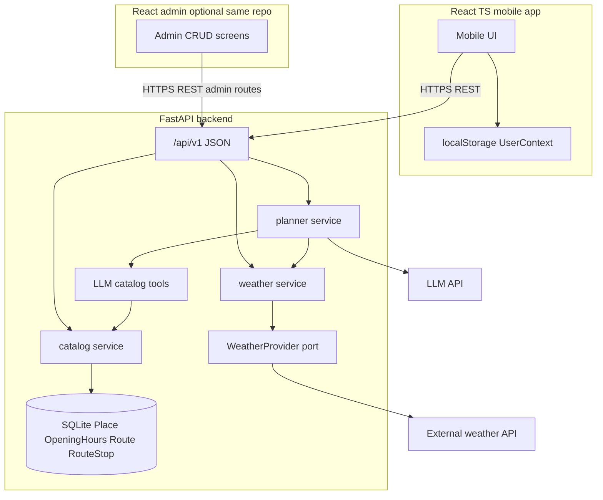

# System, API, and admin architecture (hackathon MVP)

**FastAPI** backend (this repo) + **React / TypeScript** mobile client (separate app). Catalog aligned with [catalog-db-design.md](catalog-db-design.md); planner and personas in [user-persona-llm-design.md](user-persona-llm-design.md). **Weather** via pluggable provider (target: integrate an external forecast API — e.g. Open-Meteo, OpenWeather, or a provider you import during the hackathon). **No login / registration.** **Implementation not started.**

## System overview



| Layer | Responsibility |
|-------|----------------|
| **React mobile** | Persona, packages, constraints, profile in **localStorage**; map, plan display; calls backend only (no LLM key in browser) |
| **FastAPI** | Catalog read + admin write, **POST /plan**, **weather proxy** (normalized JSON + cache), OpenAPI |
| **SQLite** | Four catalog tables only — no weather tables in MVP (optional short TTL cache in memory) |

**Repos:** `backend/` (Python) and `frontend/` or sibling repo (Vite + React + TS). Generate TS types from OpenAPI (`openapi-typescript`) when API stabilizes.

## Architecture choices

| Option | Description | Hackathon |
|--------|-------------|-----------|
| **A. Split FE/BE (chosen)** | FastAPI JSON + React PWA | Clear demo, mobile-first |
| B. FastAPI + Jinja admin | Server HTML admin | Rejected — team standard is React |
| C. Weather on client | Browser calls weather API | Rejected — hides API keys, CORS pain |

**Backend:** single FastAPI process (API + planner + weather adapter).  
**Frontend:** mobile-first React (touch, bottom nav, single column); admin as **optional** route group (`/admin/*`) with simpler desktop-friendly forms — same API, no separate auth.

## Backend layout (this repo)

```text
src/backend/
  main.py                    # uvicorn entry
  api/
    app.py                   # FastAPI, CORS, lifespan, Tortoise init
    routers/
      health.py
      places.py              # maps to Place + OpeningHours
      routes.py              # PredefinedRoute + RouteStop
      plan.py
      weather.py
      interest_packages.py
      admin_places.py        # JSON CRUD for admin UI
      admin_routes.py
    schemas/                 # Pydantic — mirror catalog fields + plan DTOs
    services/
      catalog.py             # budget, duration, opening-hours filters
      planner.py
      weather.py             # cache + provider selection
    weather/
      base.py                # WeatherProvider protocol
      open_meteo.py          # optional default free provider
      stub.py                # hackathon fallback if import fails
    tools/                   # LLM: search_places, list_routes, get_route, get_place
  db/                        # Tortoise models per catalog doc
```

No Jinja in MVP. Admin consumes **`/api/v1/admin/...`** JSON from React.

## Frontend layout (suggested)

```text
frontend/
  src/
    api/client.ts            # fetch wrapper, base URL from env
    api/types.ts             # generated or hand-written from OpenAPI
    features/
      persona/
      plan/
      catalog/
      weather/
    admin/                   # optional: places, routes, hours editors
    storage/userContext.ts   # localStorage schema_version
  index.html                 # viewport mobile, PWA manifest optional
```

**Mobile:** React Router, constraint pickers (time, budget), package chips, free-text, “Generate plan”.  
**Types:** Share `PlanRequest` / `PlanResponse` / `Place` with backend field names (English).

## Cross-cutting

| Topic | Decision |
|-------|----------|
| API prefix | `/api/v1` |
| CORS | `CORS_ORIGINS` — Vite dev `http://localhost:5173` + demo host |
| Errors | `{ "error": { "code", "message", "details" } }` |
| Pagination | `limit` (default 20, max 100), `offset` on lists |
| Timezone | `Europe/Warsaw`; opening hours = local wall clock |
| OpenAPI | `/docs` — source for TS codegen |
| Secrets | `LLM_*`, `WEATHER_*` only on server |

`ADMIN_ENABLED=false` disables admin routers in prod-like deploys (not authentication).

---

## Public API — catalog (read-only)

Resources match DB entities: **Place** (with nested **opening_hours**), **PredefinedRoute** (with **stops** → **place** summary).

### `GET /health`

`{ "status": "ok", "db": "ok" }`

### `GET /api/v1/places`

List places with filters from [catalog-db-design.md](catalog-db-design.md).

| Query param | Catalog field / rule |
|-------------|----------------------|
| `city`, `gmina` | `Place.city`, `Place.gmina` |
| `category` | `Place.category` |
| `budget_max_pln` | `price_level`, `price_max_pln` |
| `max_visit_minutes` | `typical_visit_minutes` |
| `day_of_week`, `window_start`, `window_end` | `OpeningHours` |
| `adult_only` | exclude 18+ when false |
| `is_indoor`, `is_outdoor` | booleans |
| `min_family_friendly` | optional hard filter on metric |
| `limit`, `offset` | pagination |

**Response `Place`:** all catalog columns including profile metrics (`gastro_intensity`, `game_interactivity`, `physical_activity_level`, `cultural_education`, `nature_relaxation`, `family_friendly`, `rain_suitable`).

### `GET /api/v1/places/{place_id}`

Single place + `opening_hours: [{ day_of_week, opens_at, closes_at }]`.

### `GET /api/v1/routes`

| Query param | Catalog field |
|-------------|---------------|
| `city`, `gmina` | route location |
| `max_duration_minutes` | `duration_minutes_approx` |
| `max_price_level` | `price_level_max` |
| `limit`, `offset` | pagination |

### `GET /api/v1/routes/{route_id}`

Route fields + `stops: [{ sequence, dwell_minutes, place: PlaceSummary }]`.

`PlaceSummary`: id, name, lat/lon, `typical_visit_minutes`, key metrics (for map cards).

### `GET /api/v1/interest-packages`

Static JSON (interest packages config) for UI — not stored in SQLite.

---

## Weather API (pluggable provider)

**Goals:** Support scope (“consider weather”); prefer outdoor when dry; boost `rain_suitable` places when rain expected. **No weather data in catalog DB.**

### Port pattern (open for hackathon import)

```python
# Conceptual — implement at build time
class WeatherProvider(Protocol):
    async def get_current(self, lat: float, lon: float) -> WeatherSnapshot: ...
    async def get_forecast(
        self, lat: float, lon: float, hours: int = 24
    ) -> WeatherForecast: ...
```

| Implementation | Role |
|----------------|------|
| `stub` | Fixed “clear” — local dev without keys |
| `open_meteo` | Free, no key — good default to try |
| `custom` | **Slot for API you integrate at import** (OpenWeather, IMGW, commercial “air”/aqi+weather APIs, etc.) |

Env:

| Variable | Purpose |
|----------|---------|
| `WEATHER_PROVIDER` | `stub` \| `open_meteo` \| `custom` |
| `WEATHER_API_KEY` | If provider requires it |
| `WEATHER_API_BASE_URL` | Override for custom/imported client |
| `WEATHER_CACHE_TTL_SECONDS` | Default `300` in-memory |

### Normalized response (provider-agnostic)

Backend maps any provider → these DTOs (stable for React + LLM):

**`WeatherSnapshot`**

```json
{
  "lat": 52.86,
  "lon": 19.67,
  "observed_at": "2026-10-17T10:00:00+02:00",
  "condition": "rain",
  "temperature_c": 12.5,
  "precipitation_mm_h": 0.8,
  "wind_speed_ms": 3.2,
  "is_outdoor_friendly": false
}
```

`condition` enum: `clear` | `cloudy` | `rain` | `snow` | `storm` | `unknown`  
`is_outdoor_friendly`: derived rule (e.g. rain/snow/storm → false) — tunable in one place.

**`WeatherForecast`**

```json
{
  "lat": 52.86,
  "lon": 19.67,
  "hours": [
    {
      "start": "2026-10-17T10:00:00+02:00",
      "end": "2026-10-17T11:00:00+02:00",
      "condition": "cloudy",
      "precipitation_mm_h": 0.1,
      "is_outdoor_friendly": true
    }
  ]
}
```

### Endpoints

| Method | Path | Description |
|--------|------|-------------|
| `GET` | `/api/v1/weather/current` | Query: `lat`, `lon` **or** `city` (+ optional `gmina`) — resolve coords via catalog centroid or fixed city table later |
| `GET` | `/api/v1/weather/forecast` | Query: `lat`, `lon`, `hours` (default 24) |

Errors: `502` provider failure (body includes `provider` name); client may plan without weather.

### Use in planner

`POST /api/v1/plan` may:

1. Accept optional `weather: { lat, lon }` or infer from `constraints.city` / first candidate place.
2. Call `weatherSvc` for forecast overlapping `window_start`–`window_end`.
3. Pass **`weather_context`** into LLM prompt (structured JSON, not raw provider payload).
4. Instruct LLM: prefer high `rain_suitable` when `is_outdoor_friendly` is false; prefer outdoor places when true and user wants outdoor.

Client can also call `/weather/*` for UI badges before planning.

---

## Planner API

### `POST /api/v1/plan`

Stateless. Body = [user-persona-llm-design.md](user-persona-llm-design.md) `UserContext` + optional:

```json
{
  "weather": { "lat": 52.86, "lon": 19.67 }
}
```

Flow:

1. Pydantic validate.
2. `catalog` → filtered candidates (budget, time, hours).
3. `weather` → snapshot/forecast for window (if coords/city available).
4. `planner` → Bielik on remote home server via OpenAI-compatible client; prompt assembly and JSON plan — see [llm-bielik-integration-design.md](llm-bielik-integration-design.md).
5. Validate `PlanResponse`; retry once on invalid JSON; enrich with catalog rows for UI.

**Response:** `PlanEnrichedResponse` — validated `plan` + `display` (Polish copy) + hydrated `route` / `places` map; ids must exist in catalog.

---

## Admin API (React panel, no login)

Used only by admin routes in React. Same validation as DB (metrics 0–5, required lat/lon on places).

| Method | Path | Description |
|--------|------|-------------|
| `GET` | `/api/v1/admin/places` | List (incl. pagination) |
| `POST` | `/api/v1/admin/places` | Create Place |
| `PATCH` | `/api/v1/admin/places/{id}` | Update |
| `DELETE` | `/api/v1/admin/places/{id}` | Delete |
| `PUT` | `/api/v1/admin/places/{id}/opening-hours` | Replace hours array |
| `GET` | `/api/v1/admin/routes` | List |
| `POST` | `/api/v1/admin/routes` | Create route |
| `PATCH` | `/api/v1/admin/routes/{id}` | Update |
| `DELETE` | `/api/v1/admin/routes/{id}` | Delete |
| `PUT` | `/api/v1/admin/routes/{id}/stops` | Replace ordered stops |
| `POST` | `/api/v1/admin/seed` | Dev-only demo seed |

Admin UI labels may show Polish copy; API JSON stays English snake_case matching Tortoise models.

**Screens (React):** dashboard counts, place form (metrics sliders), hours grid, route editor + drag reorder stops.

---

## What we omit (MVP)

- Auth, users on server, saved plans sync
- Catalog events/tags/media tables
- Weather history in DB
- GraphQL, SSE streaming for plan
- Direct browser → weather provider calls

---

## Dependencies (when implementing)

**Backend**

```text
fastapi
uvicorn[standard]
pydantic-settings
httpx
python-multipart
```

**Frontend (separate package)**

```text
react
react-dom
typescript
vite
react-router-dom
openapi-typescript   # optional codegen
```

---

## Environment summary

| Variable | Layer |
|----------|--------|
| `CORS_ORIGINS` | backend |
| `LLM_API_KEY`, `LLM_MODEL` | backend |
| `WEATHER_PROVIDER`, `WEATHER_API_KEY`, `WEATHER_API_BASE_URL`, `WEATHER_CACHE_TTL_SECONDS` | backend |
| `ADMIN_ENABLED` | backend |
| `VITE_API_BASE_URL` | frontend |

---

## Testing focus

| Area | Check |
|------|--------|
| Place list | `budget_max_pln` + `max_visit_minutes` + opening window |
| Route detail | `sequence` order, `dwell_minutes` |
| Weather | Provider stub + one real provider; cache hit |
| Plan | Mock LLM; weather_context changes outdoor copy |
| Admin | POST place → `GET /api/v1/places/{id}` |

---

## Decisions

1. **FastAPI** backend JSON-only; **React TS** mobile client (+ optional admin routes).
2. Catalog API fields **1:1** with [catalog-db-design.md](catalog-db-design.md).
3. **Weather** behind `WeatherProvider`; try external API at integration time without schema changes.
4. **Planner on server** with optional weather enrichment and `rain_suitable` logic in prompts.
5. **No auth**; `ADMIN_ENABLED` + deployment discipline only.

## Next step

Review with catalog and persona docs. Implementation plan: models → public catalog routers → weather port → plan → admin routers → React app wiring. **No code until explicitly requested.**
