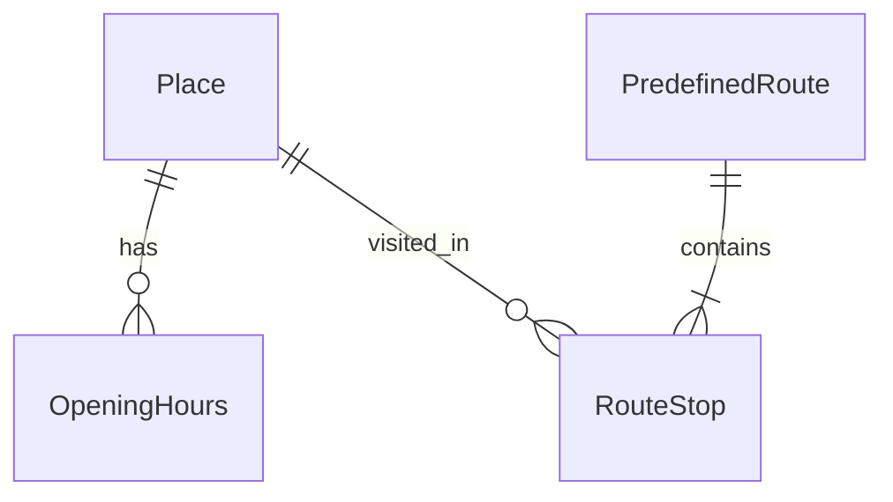

# Catalog database design (hackathon MVP)

Lean schema for the leisure-time planner. Aligned with [scope.md](../../scope.md). **Implemented** in `src/backend/db/models.py` (M1).

## MVP scope

**Build now (4 tables):** `Place`, `OpeningHours`, `PredefinedRoute`, `RouteStop`.

**Defer (post-hackathon):** `Event`, tags, `DataSource`, import sync, `OpeningException`, `Media`, normalized `Municipality`, nested categories.

User preferences (BMI, likes games, kids) stay in **client local storage**. The API returns catalog rows; the client filters by **time** and **budget**, then ranks by **profile metrics**.

**Stack:** SQLite + Tortoise ORM (`src/backend/db/config.py`).

## Filtering model (time + budget)

Client sends a planning window (example):

```json
{
  "budget_max_pln": 0,
  "available_minutes": 180,
  "day_of_week": 5,
  "window_start": "10:00",
  "window_end": "13:00"
}
```

| Filter | Server fields | Rule (MVP) |
|--------|---------------|------------|
| **Budget** | `Place.price_level`, `Place.price_max_pln` | Include if `price_level = 0` (free) OR `price_max_pln <= budget_max_pln`. If only level is known, map budget to max level (e.g. 0 PLN → level 0). |
| **Time (duration)** | `Place.typical_visit_minutes` | Include if `typical_visit_minutes <= available_minutes`. |
| **Time (open now)** | `OpeningHours` for `day_of_week` | Place is open if `window_start >= opens_at` and `window_end <= closes_at` (handle overnight in app if needed). |
| **Route fit** | `PredefinedRoute.duration_minutes_approx` | `duration_minutes_approx <= available_minutes`. Sum of stops can refine later. |

Profile metrics (below) are **not** SQL filters in MVP — client uses them for ranking after hard filters.

## Matching profile (keep fat / game style metrics)

Scale **0–5** (`0` = N/A, `5` = strong match for that dimension).

| Informal | Column | Use |
|----------|--------|-----|
| fat counter | `gastro_intensity` | Down-rank when user BMI is high |
| game counter | `game_interactivity` | Up-rank when user likes games |
| — | `physical_activity_level` | Up-rank for active / health goals |
| — | `cultural_education` | Museums, theatre |
| — | `nature_relaxation` | Outdoor / calm |
| — | `family_friendly` | Kids in the group |
| — | `rain_suitable` | Indoor / covered (weather fallback) |

Booleans on `Place`: `adult_only`, `is_indoor`, `is_outdoor`, `min_age_recommended` (exclude if kids below min).

## Entity relationship



## Enums

```text
PriceLevel:  0=free, 1=low, 2=medium, 3=high
```

Use 0–3 only for MVP; skip `premium` unless needed.

## `Place`

| Column | Type | Notes |
|--------|------|--------|
| `id` | PK | |
| `name` | string | |
| `description` | text, nullable | |
| `city` | string | |
| `gmina` | string | |
| `address_line` | string, nullable | |
| `latitude` | float | |
| `longitude` | float | |
| `category` | string | MVP: free text or enum string (`museum`, `cinema`, `restaurant`, `attraction`, `trail`) — no `Category` table yet |
| `is_indoor` | bool | |
| `is_outdoor` | bool | |
| `adult_only` | bool | |
| `min_age_recommended` | smallint, nullable | |
| `typical_visit_minutes` | int | **Time filter** |
| `price_level` | PriceLevel | **Budget filter** |
| `price_max_pln` | decimal, nullable | **Budget filter** when known |
| `gastro_intensity` | smallint 0–5 | |
| `game_interactivity` | smallint 0–5 | |
| `physical_activity_level` | smallint 0–5 | |
| `cultural_education` | smallint 0–5 | |
| `nature_relaxation` | smallint 0–5 | |
| `family_friendly` | smallint 0–5 | |
| `rain_suitable` | smallint 0–5 | |
| `created_at` | datetime | |
| `updated_at` | datetime | |

No `slug`, `status`, or import columns in MVP unless you need draft/publish for seeding.

## `OpeningHours`

| Column | Type | Notes |
|--------|------|--------|
| `id` | PK | |
| `place_id` | FK → Place | |
| `day_of_week` | 0–6 | Monday = 0 |
| `opens_at` | time (stored as `HH:MM` string in MVP) | |
| `closes_at` | time (stored as `HH:MM` string in MVP) | |

**Index:** `(place_id, day_of_week)`.

Skip seasonal `valid_from` / `valid_until` and `OpeningException` until after demo.

## `PredefinedRoute`

| Column | Type | Notes |
|--------|------|--------|
| `id` | PK | |
| `name` | string | |
| `description` | text, nullable | |
| `duration_minutes_approx` | int | **Time filter** |
| `stops_min` | int | N in N–M (stop count) |
| `stops_max` | int | M in N–M |
| `city` | string | |
| `gmina` | string | |
| `price_level_max` | PriceLevel, nullable | **Budget filter** for whole route |

## `RouteStop`

| Column | Type | Notes |
|--------|------|--------|
| `id` | PK | |
| `route_id` | FK → PredefinedRoute | |
| `place_id` | FK → Place | |
| `sequence` | int | 1, 2, 3… |
| `dwell_minutes` | int, nullable | Overrides `Place.typical_visit_minutes` for route planning |

**Unique:** `(route_id, sequence)`.

## Out of scope (this database)

- `User`, saved plans, preference persistence
- Scoring formulas (BMI × `gastro_intensity`, etc.)
- Events calendar, multi-source sync, tags, media

## Post-MVP extensions (reference only)

Add when needed: `Category` table, `Event`, `OpeningException`, `Tag`/`PlaceTag`, `DataSource`, `ticket_url`, `parking_available`, extra profile axes (`romantic`, `energy_required`, …).

## Implementation

Single migration batch: four models in `src/backend/db/models.py`, seed JSON at `data/seed/catalog.json`. Load with `uv run backend-seed` (`--force` to replace catalog rows).

## Decisions

1. **N–M on routes:** number of stops, not group size.
2. **Budget:** `price_level` + optional `price_max_pln`; routes use `price_level_max`.
3. **Time:** `typical_visit_minutes` + `OpeningHours` + route `duration_minutes_approx`.
4. **Language:** English column names; Polish content in seed data is fine.
