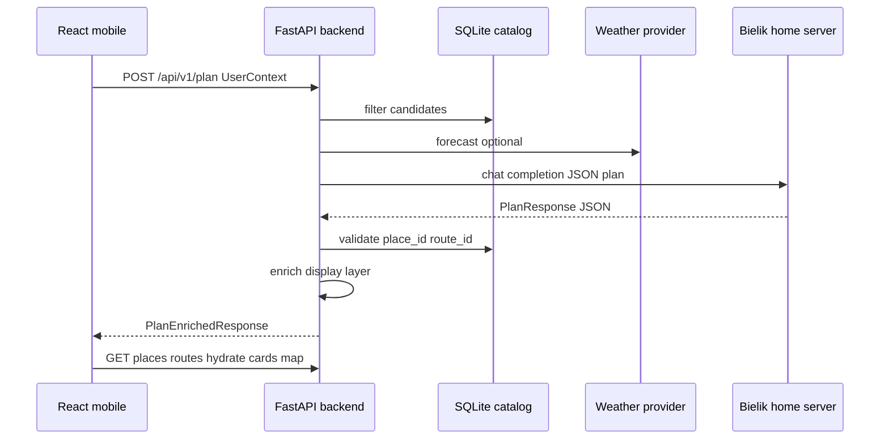
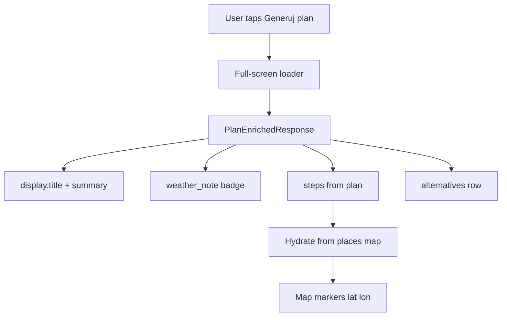

# LLM integration — Bielik (remote) and planner prompts

How the **FastAPI** backend talks to **Bielik** on a **separate home server**, how context is injected into prompts, and how the **React mobile** app displays results. Complements [user-persona-llm-design.md](user-persona-llm-design.md), [catalog-db-design.md](catalog-db-design.md), and [api-admin-design.md](api-admin-design.md). **Implementation not started.**

## Deployment topology



| Component | Host | Notes |
|-----------|------|--------|
| React app | User phone / static CDN | Only `VITE_API_BASE_URL`; no Bielik URL |
| FastAPI + SQLite | Hackathon / cloud VPS | Orchestrates plan; holds catalog |
| **Bielik** | **Home server** (different machine) | Inference only; reachable via VPN/tunnel or public HTTPS with token |
| Weather | External API | Via backend proxy |

**Assumption:** Bielik is exposed through an **OpenAI-compatible** HTTP API (common: **Ollama**, **vLLM**, **LocalAI**, **text-generation-webui** OpenAI extension). Backend uses one client adapter (`LLM_BASE_URL`, `LLM_MODEL`, `LLM_API_KEY`).

## Integration approaches

| Approach | Flow | Bielik fit | Recommendation |
|----------|------|------------|----------------|
| **A. Orchestrator + one shot** | Python filters DB → inject compact candidate JSON → single completion → strict JSON schema | Works well; limited tool syntax | **MVP default** |
| B. Tool-calling loop | Model calls `search_places` etc. over many turns | Weaker on small Polish models; higher latency over home link | Post-MVP if model supports it |
| C. Two-shot | Shot 1: JSON plan (English keys); Shot 2: Polish `display` prose only | Extra home-server round trip; reliable UX copy | **Optional** if shot 1 JSON is ugly |

**Choice for hackathon:** **A**, with optional **C** for polish of user-visible text without risking invalid ids in shot 2.

## Backend module layout (conceptual)

```text
src/backend/
  llm/
    client.py           # OpenAI-compatible HTTP to home Bielik
    prompts/
      system_core.pl.md # static rules (Polish)
      tourist.pl.md
      resident.pl.md
    assembler.py        # build messages from PlanRequest + context blobs
    parser.py           # extract JSON, validate PlanResponse, retry once
  services/
    planner.py          # orchestrate filter → llm → validate → enrich
    plan_enricher.py    # attach catalog names, coords, prices for UI
```

## Prompt assembly — what goes where

Use **chat messages**, not one giant string. Keep **system** stable; put **session data** in **user** message as labeled JSON blocks (Bielik reads Polish instructions + structured data well).

### Message roles

| Role | Content |
|------|---------|
| **system** | Role, output format, hard rules (ids only from candidates), persona rules, weather rules — mostly **static files** + one **persona** snippet |
| **user** | Injected runtime JSON: `user_context`, `interest_package`, `weather_context`, `candidates` |
| **assistant** | Only in retry turn: previous invalid output + validation errors |

Do **not** put the full catalog in the system prompt. System prompt size stays small; data injection is per request in **user**.

### System prompt

Full prompt text, persona fragments, retry message, and design decisions live in **[llm-system-prompt-spec.md](llm-system-prompt-spec.md)**.

Runtime assembly: `system_core.pl.md` + `tourist.pl.md` **or** `resident.pl.md` (no session data in system). Persona behavior also summarized in [user-persona-llm-design.md](user-persona-llm-design.md).

### User message — injected blocks (order matters)

Assembler builds one user message:

```text
Zadanie: zaproponuj plan na podstawie danych poniżej.

<USER_CONTEXT>
{{ json.dumps(user_context, ensure_ascii=False) }}
</USER_CONTEXT>

<INTEREST_PACKAGE>
{{ json.dumps(package_config or null) }}
</INTEREST_PACKAGE>

<WEATHER_CONTEXT>
{{ json.dumps(weather_context or null) }}
</WEATHER_CONTEXT>

<CANDIDATES>
{
  "routes": [ ... max 5 slim objects ... ],
  "places": [ ... max 15 slim objects ... ]
}
</CANDIDATES>

Schemat odpowiedzi PlanResponse:
{{ json_schema_or_compact_example }}
```

### Candidate slim shape (token control)

Home link may be slow; keep payloads small. Include fields needed for choice + narration:

**Place candidate**

```json
{
  "place_id": 12,
  "name": "Muzeum …",
  "category": "museum",
  "typical_visit_minutes": 90,
  "price_level": 0,
  "price_max_pln": null,
  "is_indoor": true,
  "is_outdoor": false,
  "adult_only": false,
  "min_age_recommended": 0,
  "gastro_intensity": 1,
  "game_interactivity": 0,
  "physical_activity_level": 1,
  "cultural_education": 5,
  "nature_relaxation": 0,
  "family_friendly": 4,
  "rain_suitable": 5,
  "opens_today": "10:00-17:00"
}
```

**Route candidate**

```json
{
  "route_id": 3,
  "name": "Szlak …",
  "duration_minutes_approx": 180,
  "stops_min": 3,
  "stops_max": 5,
  "price_level_max": 1,
  "stop_place_ids": [5, 8, 12]
}
```

Filtering logic matches [catalog-db-design.md](catalog-db-design.md) (budget, duration, opening hours). If zero candidates → **do not call Bielik**; return `422` with a clear message for the UI.

### Mapping user profile → prompt hints

Inject derived hints in `USER_CONTEXT` (computed in Python, not by the model):

| Client field | Inject as |
|--------------|-----------|
| `profile.bmi` high | `"health_hint": "obniż wagę gastro_intensity; podnieś physical_activity_level"` |
| `profile.likes_games` high | `"game_hint": "preferuj wysokie game_interactivity"` |
| `custom_request` | verbatim string |
| `interest_package_id` | full package block + merged `profile_weights` |

Package weights from config align with catalog metric names so Bielik can compare numerically to candidate rows.

## Bielik client (home server)

### Configuration

| Env | Example | Purpose |
|-----|---------|---------|
| `LLM_BASE_URL` | `https://bielik.home.example/v1` | OpenAI-compatible base |
| `LLM_MODEL` | `speakleash/bielik-7b` or local tag | Model id on server |
| `LLM_API_KEY` | shared secret | If home endpoint is protected |
| `LLM_TIMEOUT_SECONDS` | `120` | Home uplink can be slow |
| `LLM_MAX_TOKENS` | `2048` | Cap completion |
| `LLM_TEMPERATURE` | `0.2` | Lower for JSON fidelity |

### Request shape (OpenAI-compatible)

```json
{
  "model": "{{ LLM_MODEL }}",
  "messages": [
    { "role": "system", "content": "..." },
    { "role": "user", "content": "..." }
  ],
  "temperature": 0.2,
  "response_format": { "type": "json_object" }
}
```

If Bielik stack ignores `response_format`, enforce JSON via system prompt + parser retry.

### Resilience

| Case | Behavior |
|------|----------|
| Timeout / connection error | `503` to app; UI: “Planner unavailable, try again” |
| Invalid JSON | One retry with assistant message: validation errors + “popraw JSON” |
| Invalid ids in plan | Reject; retry once; else `422` |
| Home server down | Optional **stub planner**: pick top route (tourist) or top 3 places by package weights — dev only, flag `PLANNER_STUB=true` |

**Security:** TLS or WireGuard to home; never expose Bielik to the public internet without API key. Backend is the only caller.

## Model output — PlanResponse (machine layer)

Same schema as [user-persona-llm-design.md](user-persona-llm-design.md). Required fields:

| Field | UI use |
|-------|--------|
| `title` | Header (Polish from model) |
| `primary_type` | `route` \| `places` |
| `route_id` | Load route + stops |
| `steps[]` | Timeline; `place_id`, times, `reason` |
| `alternatives[]` | Chips / secondary cards |
| `tips[]` | Bullet list |

**Rule:** React treats LLM text as **copy**; **names, addresses, coordinates, prices** come from catalog API after id validation.

## API response to mobile — PlanEnrichedResponse

`POST /api/v1/plan` returns one object for rendering (extend [api-admin-design.md](api-admin-design.md)):

```json
{
  "plan": { /* validated PlanResponse */ },
  "display": {
    "title": "Sobota z dziećmi na świeżym powietrzu",
    "summary": "Krótki opis całego planu po polsku.",
    "weather_note": "Pada — mamy alternatywę pod dach."
  },
  "route": { /* PredefinedRoute + stops with embedded place summaries, if route_id set */ },
  "places": { "12": { /* full Place + opening_hours */ } },
  "meta": {
    "planner": "bielik",
    "candidates_routes": 2,
    "candidates_places": 11,
    "weather_used": true
  }
}
```

`display` may come from:

- **Single-shot:** fields inside `PlanResponse` (`title`, `tips`, step `reason`), or
- **Two-shot (optional):** second Bielik call with fixed plan JSON → only `summary` + `weather_note` prose.

`plan_enricher` loads all referenced ids from SQLite; drops steps with missing ids before response.

## React — how to show data to the user



| UI block | Data source | Never from LLM alone |
|----------|-------------|----------------------|
| Title / summary | `display` | — |
| Step time | `plan.steps[].start_time` | — |
| Place name, address | `places[place_id].name`, `address_line` | ✓ |
| Price | `price_level`, `price_max_pln` | ✓ |
| Map pin | `latitude`, `longitude` | ✓ |
| “Why this place?” | `plan.steps[].reason` | Polish copy OK |
| Route overview | `route.name`, ordered stops | ✓ |
| Open in maps | built from catalog coords | ✓ |

**Tourist:** if `primary_type === "route"`, hero card = route; steps = stop list.  
**Resident:** hero = first place or compact list; alternatives prominent.

**Errors**

| HTTP | UI |
|------|-----|
| `422` | “Brak pasujących miejsc — zmień czas lub budżet” |
| `503` | “Planer chwilowo niedostępny” + retry |
| Partial enrich failure | Should not happen if validation is strict |

Store last successful `PlanEnrichedResponse` in sessionStorage optional for back navigation — not server.

## Optional second Bielik call (display polish)

Only if single-shot JSON is reliable but Polish prose is weak:

1. **User message:** “Oto plan JSON: … Napisz summary i weather_note po polsku, max 3 zdania. JSON: `{ \"summary\": \"...\", \"weather_note\": \"...\" }`”
2. Merge into `display` without changing ids or steps.

Same `LLM_BASE_URL`; no catalog in second call.

## Testing without home server

| Mode | Use |
|------|-----|
| `PLANNER_STUB=true` | Deterministic plan from weights |
| Recorded fixtures | `tests/fixtures/bielik_plan.json` |
| Mock HTTP | Point `LLM_BASE_URL` to pytest mock |

## Decisions

1. **Bielik on home server** — backend calls OpenAI-compatible API; mobile never sees it.
2. **Orchestrator pattern** — DB filter in Python; inject **CANDIDATES** + context in **user** message; persona rules in **system**.
3. **Polish** for user-facing strings in model output; **English JSON keys** for parsers and TypeScript types.
4. **PlanEnrichedResponse** — LLM plan + catalog hydration for trustworthy UI.
5. **Tool-calling loop** deferred unless Bielik variant proves reliable.

## Next step

Review this doc with the other specs. When approved, add `PlanEnrichedResponse` to API doc and implementation plan (llm client → assembler → planner → enricher). **No code until explicitly requested.**
