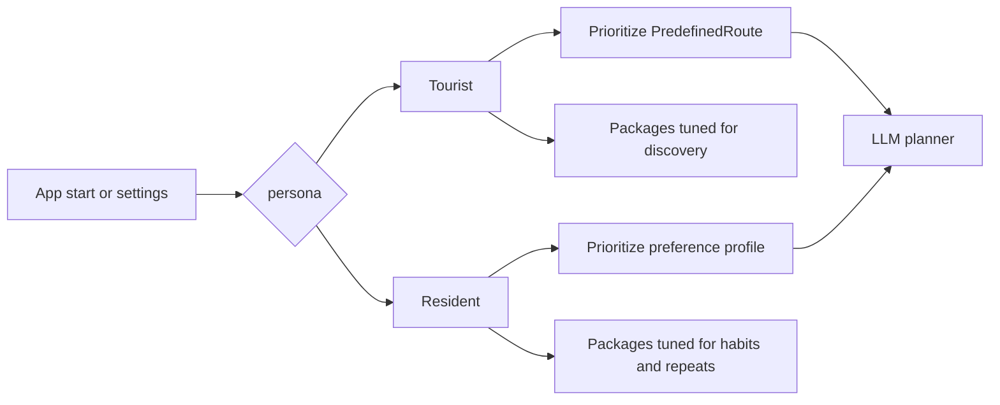

# User persona and LLM planning design (hackathon MVP)

How the app models the user on the **client**, splits **tourist vs resident** journeys, and feeds an **LLM** that searches the catalog and proposes plans. Pairs with [catalog-db-design.md](catalog-db-design.md). **No server-side user tables in MVP** — persistence is local storage (or client-side DB). **Implementation not started.**

## Goals

| Goal | Approach |
|------|----------|
| Two audiences | Explicit `persona`: `tourist` \| `resident` — changes defaults, copy, and what the LLM prioritizes |
| Tourist | Surface **PredefinedRoute** first; places as supporting detail |
| Resident | Surface **preferences** and **Place** discovery; routes optional |
| Low friction | **Interest packages** (one-tap presets) + optional **free-text** request |
| LLM-first | LLM interprets text, calls tools over catalog data, returns a structured plan — not hand-written ranking in the UI |

## What we do not build (MVP)

- Backend `User` / auth / sync
- Server-stored preference history (optional export/share later)
- LLM training or fine-tuning — one system prompt + tools + catalog JSON/SQLite API

## Personas



| | **Tourist** | **Resident** |
|---|-------------|--------------|
| Primary catalog entity | `PredefinedRoute` | `Place` |
| Typical ask | “What to see in 1 day?” / “Classic Sierpc trail” | “Something new this Saturday, free, with kids” |
| LLM bias (prompt) | Recommend 1–2 **routes**; fill gaps with single places only if needed | Recommend **places** or a custom mini-itinerary; mention routes only if user asks or package implies it |
| Default packages shown | Heritage walk, city highlights, family day trip | Active weekend, cheap outing, date night, try something new |

User can switch persona in settings; stored locally.

## Local user model (client storage)

Single JSON document (versioned). Example shape:

```json
{
  "schema_version": 1,
  "persona": "resident",
  "interest_package_id": "active_family",
  "custom_request": "",
  "constraints": {
    "budget_max_pln": 0,
    "available_minutes": 180,
    "day_of_week": 5,
    "window_start": "10:00",
    "window_end": "13:00",
    "party": { "adults": 2, "kids_ages": [5, 8] }
  },
  "profile": {
    "bmi": null,
    "likes_games": 3,
    "prefer_outdoor": true,
    "gastro_intensity_preference": 2,
    "physical_activity_preference": 4
  },
  "last_plan_id": null
}
```

### Field roles

| Area | Purpose |
|------|---------|
| `persona` | Routes **tourist** vs **resident** LLM instructions and UI defaults |
| `interest_package_id` | Selected preset; merges into `profile` + `llm_context` |
| `custom_request` | Raw user language (Polish expected in UI); LLM parses and overrides/extends presets for this session |
| `constraints` | Hard filters aligned with catalog doc (time, budget, opening window, party) |
| `profile` | Soft signals mapped to catalog metrics (`gastro_intensity`, `game_interactivity`, etc.) for ranking hints in the prompt |

`bmi` stays on client only; never sent to a user table on server. May be included in the LLM context block for ranking instructions (down-rank high `gastro_intensity` places).

## Interest packages (presets)

Fixed list shipped with the app (JSON config, not DB). User picks **one** package per planning session (can change before “Plan”). Packages are **LLM-optimized**: each has a stable `id`, human label, and machine-readable weights.

### Package record (config file)

```json
{
  "id": "game_adrenaline",
  "label_pl": "Gry i adrenalina",
  "personas": ["resident", "tourist"],
  "profile_weights": {
    "game_interactivity": 5,
    "physical_activity_level": 4,
    "gastro_intensity": 1
  },
  "profile_preferences": {
    "likes_games": 5
  },
  "llm_hint": "Prefer paintball, shooting ranges, arcades, laser tag. Avoid slow museum-only days unless user asks.",
  "prefer_entity": "place"
}
```

| Field | Notes |
|-------|--------|
| `profile_weights` | Desired **place** attribute levels (0–5) — tell LLM what to favor when reading catalog rows |
| `profile_preferences` | Client-side knobs (e.g. `likes_games`) for prompt text |
| `llm_hint` | Short English or Polish instruction fragment injected into the planner prompt |
| `prefer_entity` | `route` \| `place` — default retrieval bias; **tourist** packages often set `route` |

### Suggested MVP packages (8–10)

| id | Label (PL) | Persona emphasis | `prefer_entity` | Notes |
|----|------------|------------------|-----------------|--------|
| `city_highlights` | Najważniejsze w mieście | tourist | route | Map to 1–2 `PredefinedRoute` |
| `heritage_day` | Dziedzictwo i kultura | both | route / place | High `cultural_education` |
| `active_family` | Rodzinnie i aktywnie | both | place | High `family_friendly`, `physical_activity_level` |
| `game_adrenaline` | Gry i adrenalina | both | place | High `game_interactivity` |
| `nature_chill` | Natura i spokój | both | place | High `nature_relaxation` |
| `budget_free` | Za darmo | resident | place | `budget_max_pln: 0` suggested in UI |
| `food_explorer` | Smaki regionu | tourist | place | High `gastro_intensity` (warn in hint if BMI high in profile) |
| `health_active` | Ruch zamiast jedzenia | resident | place | Low gastro, high `physical_activity_level` |
| `rain_plan_b` | Plan na deszcz | both | place | High `rain_suitable` |
| `custom` | Własne słowa | both | — | Only `custom_request`; no preset weights |

**Custom path:** `interest_package_id: "custom"` — user types in NL; LLM infers weights and constraints from text without requiring a matching preset.

## Tourist vs resident — LLM behavior

### Shared pipeline

1. Load local user doc + selected package config.
2. **Deterministic pre-filter** (app or thin API): places/routes matching `constraints` (budget, duration, opening hours) — small candidate set.
3. **LLM call** with system rules + **structured user context** + **candidate catalog slice** (or tool access to fetch).
4. LLM returns **structured plan** (JSON schema below); UI renders map, times, copy.

### Persona-specific system rules (summary)

**Tourist**

- First output option must be a **PredefinedRoute** if any candidate route fits `available_minutes` and budget.
- Describe route stops in order; add practical tips (parking, tickets) from place fields.
- Suggest at most one alternative route.

**Resident**

- Do **not** lead with a predefined route unless package `prefer_entity` is `route` or user text mentions “trasa” / “wycieczka”.
- Propose 2–4 **places** or a loose sequence; emphasize novelty and fit to `profile`.
- Respect `custom_request` literally when it conflicts with package (package is default, text wins for this session).

## LLM optimization

### Principles

1. **Structured context over prose** — send JSON blocks the model can scan (`constraints`, `profile`, `package`, `persona`).
2. **Small candidate sets** — pre-filter in code; LLM chooses and narrates, does not search 500 rows from scratch.
3. **Tools** — optional multi-turn tool loop; for **Bielik on a remote home server** the MVP uses **orchestrator + candidate injection** instead (see [llm-bielik-integration-design.md](llm-bielik-integration-design.md)). Reference tools if the model stack later supports them:

| Tool | Input | Output |
|------|--------|--------|
| `list_routes` | city, gmina, max_duration_minutes, max_price_level | Route summaries + stop ids |
| `get_route` | route_id | Route + ordered places with metrics |
| `search_places` | city, gmina, filters (budget, minutes, indoor, adult_only) | Place list with profile fields |
| `get_place` | place_id | Full place + opening hours for `day_of_week` |

4. **Stable ids** — plans reference `place_id` / `route_id` so UI can hydrate from catalog without hallucinating venues.
5. **One shot + repair** — if JSON validation fails, one retry with error message (no user-visible loop in MVP).

### User message assembly (conceptual)

```text
[USER_CONTEXT]
persona: resident
package: active_family
custom_request: "chcemy cos bezplatnego na swiezym powietrzu"
constraints: { ... }
profile: { ... }
package_hint: "Prefer parks, playgrounds, easy trails..."

[CANDIDATES]   // optional if not using tools
routes: [...]
places: [...]

Task: Propose a feasible plan. Return JSON only matching PlanResponse schema.
```

Free-text (`custom_request`) is always appended for the LLM to parse intent (budget, kids, mood) even when a package is selected.

### Plan response schema (LLM output)

```json
{
  "title": "Saturday with kids — outdoor, free",
  "persona_used": "resident",
  "primary_type": "places",
  "route_id": null,
  "steps": [
    {
      "sequence": 1,
      "place_id": 12,
      "start_time": "10:00",
      "end_time": "11:30",
      "reason": "Free entry, high family_friendly, open in window"
    }
  ],
  "alternatives": [
    { "place_id": 34, "reason": "If rain, high rain_suitable" }
  ],
  "tips": ["Bring snacks", "Parking at ..."]
}
```

For **tourist** + matching route:

```json
{
  "primary_type": "route",
  "route_id": 3,
  "steps": [ { "sequence": 1, "place_id": 5, "dwell_minutes": 45 }, ... ],
  "alternatives": [ { "route_id": 7, "reason": "Shorter option" } ]
}
```

## UI flow (MVP)

1. Choose **Tourist** or **Resident** (remember choice).
2. Set **time window** and **budget** (required for filtering).
3. Pick **interest package** or **Custom** + optional text field.
4. Optional: expand **advanced profile** (BMI, likes games, kids) — resident sees this more prominently.
5. **Generate plan** → LLM → show itinerary + map links.

Tourist screen: package carousel biased to `prefer_entity: route`. Resident: package grid biased to lifestyles + prominent custom text.

## Mapping packages → catalog metrics

Use the same 0–5 axes as [catalog-db-design.md](catalog-db-design.md):

`gastro_intensity`, `game_interactivity`, `physical_activity_level`, `cultural_education`, `nature_relaxation`, `family_friendly`, `rain_suitable`.

Pre-filter: SQL/API on budget, minutes, hours.  
LLM: compare candidate row metrics to `profile_weights` from package + inferred weights from `custom_request`.

## Privacy and API

- MVP: no account; optional anonymous session id for rate limiting only.
- Request to LLM provider: include only catalog facts + user context user agreed to send; document in privacy copy.
- Do not log raw `custom_request` on server in MVP unless needed for debugging (off by default).
- **Weather:** mobile app may call `GET /api/v1/weather/*` (see [api-admin-design.md](api-admin-design.md)); planner can attach `weather_context` when `POST /api/v1/plan` includes coords or city. Client does not call external weather APIs directly.

## Implementation artifacts (when building)

| Artifact | Location (suggested) |
|----------|----------------------|
| Interest packages | `client/config/interest-packages.json` or shared `data/interest-packages.json` |
| User schema | `client/types/user-context.ts` or Pydantic model in shared package |
| LLM prompt templates | `prompts/planner-tourist.md`, `prompts/planner-resident.md` |
| Plan JSON schema | `schemas/plan-response.json` |

Backend stays catalog-only; planner endpoint is optional (`POST /plan` stateless: body = user context + persona, server runs filter + LLM).

## Decisions

1. **Two paths** = `persona` flag + different LLM system prompts and UI defaults, not two apps.
2. **Packages** = config, not SQL — fast hackathon iteration.
3. **Custom text** always available; overrides package for the current session when explicit.
4. **LLM** owns natural language and final selection; code owns hard filters and id integrity.

## Next step

Review alongside [catalog-db-design.md](catalog-db-design.md). When approved, implementation plan: shared JSON schema, package seed file, read-only catalog API/tools, then planner integration. **No code until explicitly requested.**
