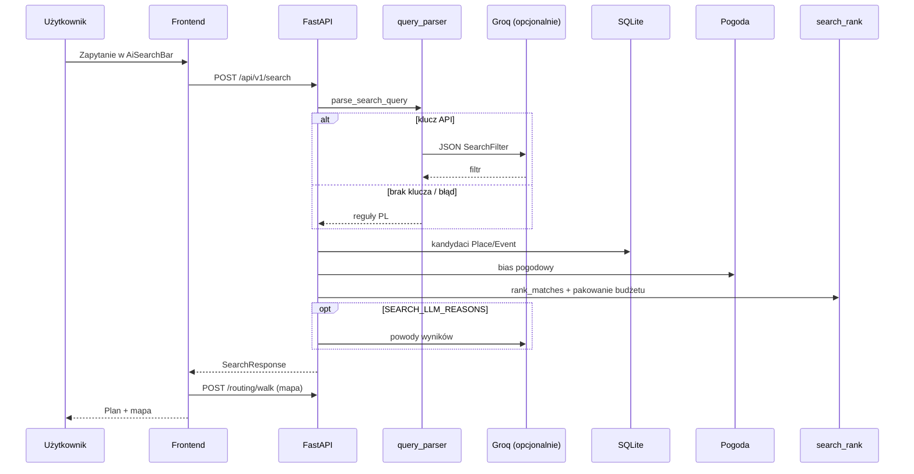

# Wyszukiwarka i tech stack projektu

Planer czasu wolnego dla regionu Płocka i okolic (Sierpc, Gostynin, gminy ościenne). Repozytorium jest podzielone na **backend** (API) i **frontend** (aplikacja mobilna w przeglądarce).

---

## Tech stack

### Backend

| Warstwa | Technologia |
|--------|-------------|
| Język | Python ≥ 3.13 |
| Pakiety / uruchomienie | [uv](https://docs.astral.sh/uv/) (`pyproject.toml`, `uv sync`, `uv run`) |
| API | [FastAPI](https://fastapi.tiangolo.com/) + [Uvicorn](https://www.uvicorn.org/) |
| Walidacja / konfiguracja | Pydantic v2, `pydantic-settings` (`.env`) |
| ORM i baza | [Tortoise ORM](https://tortoise.github.io/) + **SQLite** (`data/backend.db`) |
| HTTP klient | `httpx` (LLM, pogoda, OSRM) |
| Testy | `pytest`, `pytest-asyncio` |

**Integracje zewnętrzne (opcjonalne):**

- **LLM (Groq)** — OpenAI-compatible API (`GROQ_API_KEY`, domyślnie model `openai/gpt-oss-120b`). Parsowanie zapytań NL i opcjonalne „powody” wyników (`SEARCH_LLM_REASONS=true`).
- **Pogoda** — provider konfigurowalny (`weather_provider`, domyślnie `stub`).
- **Routing pieszy** — OSRM (`osrm_base_url`, domyślnie publiczny `router.project-osrm.org`).

Katalog miejsc, wydarzeń i tras jest ładowany z CSV (`backend/data/csv_seed/`) poleceniem `uv run backend-seed`.

### Frontend

| Warstwa | Technologia |
|--------|-------------|
| Język | TypeScript |
| UI | React 19 |
| Bundler / dev | Vite 8 |
| Stylowanie | Tailwind CSS v4 (`@tailwindcss/vite`) |
| Komponenty | shadcn/ui (Radix Slot, CVA, `clsx`, `tailwind-merge`) |
| Ikony | lucide-react |
| Nawigacja | react-router-dom v7 (część flow nadal w stanie `App.tsx`) |
| Mapa | Leaflet + react-leaflet |
| Lint | oxlint |

Zmienne środowiska: `VITE_API_BASE_URL` (puste = proxy Vite `/api` → backend `:8000` w dev), `VITE_DEVICE_MOCK` (ramka telefonu na home).

### Architektura w skrócie

```
[React PWA]  --POST /api/v1/search-->  [FastAPI]
                                            |
                    +-----------------------+-----------------------+
                    |                       |                       |
              parse_search_query      Tortoise/SQLite         weather / OSRM
              (LLM lub reguły PL)     Place, Event,              (opcjonalnie)
                                      OpeningHours
                    |
              rank_matches (deterministyczny)
                    |
              opcjonalnie explain_results (LLM)
```

---

## Wyszukiwarka — cel i granice

Wyszukiwarka **nie** wybiera miejsc przez model językowy. LLM (gdy jest skonfigurowany) służy wyłącznie do zamiany polskiego zdania na strukturę **`SearchFilter`** (data, budżet czasu, skład grupy, cena, indoor/outdoor, miasto, kategorie zainteresowań, liczba przystanków). **Ranking i dobór kandydatów** odbywają się w Pythonie na podstawie katalogu w bazie.

Główny endpoint: **`POST /api/v1/search`**

Implementacja: `backend/src/backend/api/routers/search.py` → `backend/services/search.py` (`search_catalog`).

---

## Przepływ od UI do wyniku

### 1. Frontend

1. Użytkownik wpisuje zapytanie w **`AiSearchBar`** na ekranie głównym (`HomePage`).
2. `App.tsx` przełącza widok na **`SearchResultsPage`** z przekazanym `query`.
3. `SearchResultsPage` wywołuje **`searchNaturalLanguage`** (`frontend/src/lib/searchApi.ts`):
   - `POST {VITE_API_BASE_URL}/api/v1/search`
   - body: `{ query, user_preferences? }`
4. Preferencje z onboardingu (`localStorage`, klucz kontekstu użytkownika) są dołączane tylko po ukończeniu onboardingu (`searchPreferencesFromContext`): persona, tagi zainteresowań, profil (np. aktywność fizyczna, gastro), ograniczenia, zakres geografii turysty.
5. Wyniki są renderowane jako plan: karty miejsc/wydarzeń, mapa (`PlanTrailMap`), trasa piesza przez **`/api/v1/routing/walk`** (OSRM) lub linia prosta jako fallback.

**Uwaga:** Ten sam ekran obsługuje **predefiniowane trasy** (`predefinedRouteId`) — wtedy dane pochodzą z `GET /api/v1/routes/{id}`, a nie z wyszukiwarki NL.

### 2. Parsowanie zapytania (`parse_search_query`)

Plik: `backend/src/backend/llm/query_parser.py`.

1. Zawsze liczone są **reguły polskie** (`parse_search_query_rules`): normalizacja diakrytyków, wykrywanie dnia tygodnia/dat, budżetu czasu, „za darmo” / tanio, indoor/outdoor, miast z listy `_CITY_STEMS`, fraz zainteresowań (`_INTEREST_PHRASES`), liczby dzieci itd.
2. Jeśli jest **`GROQ_API_KEY`** (lub `LLM_API_KEY`):
   - drugie przejście przez LLM z promptem `search_filter.pl.md` i JSON Schema (`search_filter_json_schema`);
   - wynik walidowany jako `SearchFilter`;
   - przy błędzie sieci/walidacji — **fallback do reguł** (`parser: "rules"` w odpowiedzi).
3. Bez klucza API zwracany jest wyłącznie wynik reguł (`parser: "rules"`).
4. Do zapytania dla LLM doklejany jest sufiks z onboardingu (`preferences_query_suffix`), żeby model widział preferencje bez mieszania ich z intencją użytkownika w rankingu.

### 3. Warstwy zainteresowań (`resolve_interest_layers`)

Plik: `backend/services/search_preferences.py`.

- **`query`** — temat wynikający z wypowiedzi (reguły tekstowe mają pierwszeństwo nad kategoriami z LLM).
- **`preference`** — tagi z onboardingu, stosowane **miękko** w rankingu, gdy zapytanie jest ogólne.
- `merge_user_preferences` scala filtr z LLM/reguł z ograniczeniami użytkownika (np. budżet, geografia).

Przy wyszukiwaniu **konkretnego obiektu** (mocne dopasowanie nazwy w katalogu) profil z onboardingu jest ignorowany w rankingu (`venue_focus`).

### 4. Kandydaci z bazy

**Miejsca** (`_candidate_places`):

- filtry twarde: miasto, brak `adult_only` przy dzieciach, strict indoor/outdoor, strict cena;
- przy ustawionym `day_of_week` — odrzucenie miejsc zamkniętych tego dnia (na podstawie `OpeningHours`).

**Wydarzenia** (`_candidate_events`):

- tylko gdy parser ustawi **`date`**;
- `start_date` = ta data, opcjonalnie miasto;
- dodatkowe filtrowanie semantyczne (`filter_events_for_query`, np. koncert vs kino, mecz).

### 5. Dopasowanie nazw obiektów (`search_venue_mention`)

Jeśli zapytanie zawiera silne wzmianki o nazwie miejsca/wydarzenia (tokeny, frazy, aliasy), kandydaci dostają **boost** w score. Przy „mocnym” dopasowaniu (`strong_mention_keys`):

- wyniki ograniczone do tych kluczy;
- limit do 3 pozycji;
- preferencja indoor/outdoor jest zneutralizowana (`EITHER`).

### 6. Ranking (`search_rank.py`)

Dla każdego kandydata budowany jest `ScoreInput` (kategoria, atrybuty miejsca: family_friendly, rain_suitable, poziomy aktywności/gastro/kultury/natury, indoor/outdoor, cena, typ place/event).

Funkcja **`score_match`** sumuje m.in.:

| Sygnał | Zachowanie |
|--------|------------|
| Kategorie z zapytania vs onboarding | Wyższa waga dla `layers.query`, niższa dla `layers.preference` |
| Dzieci w grupie | `family_friendly`, kary za `min_age_recommended` |
| Profil użytkownika | Gry, aktywność, gastro (z uwzględnieniem BMI), outdoor |
| Ustawienie indoor/outdoor | Bonusy/kary; przy deszczu inne wagi |
| Pogoda (`WeatherBias`) | Deszcz → bonus za `rain_suitable` i indoor, kara za same outdoor |
| Cena | Nieznana cena przy „za darmo” strict — kara |
| Intencja wydarzenia | Bonus dla eventów, kara dla „sal” gdy użytkownik szuka koncertu/meczu |

Po rankingu: **`_apply_query_relevance`** (boost nazw wydarzeń, kary dla sal przy intencji eventowej) oraz **`_pack_ranked_within_budget`** — pakowanie wyników tak, by **suma `typical_visit_minutes`** (lub czasu trwania eventu) mieściła się w `time_budget_minutes` i/lub `stop_count`. Bez jawnego planu czasu system domyślnie stara się zaproponować **co najmniej 2 przystanki** (`_MIN_STOPS_WITHOUT_EXPLICIT_PLAN`).

Domyślna lokalizacja pogody: współrzędne Płocka (nadpisywalne `lat`/`lon` w żądaniu).

### 7. Opcjonalne uzasadnienia LLM

Gdy `SEARCH_LLM_REASONS=true` i jest klucz API, drugie wywołanie LLM (`search_reasons.pl.md`) uzupełnia pole **`reason`** (krótki tekst po polsku, max ~160 znaków) dla topowych wyników. Błędy są ignorowane — wyniki i tak wracają bez powodów.

### 8. Odpowiedź API (`SearchResponse`)

Kluczowe pola:

- `query`, `summary` — nagłówek planu (filtr lub nazwy przy venue focus);
- `filter` — pełny `SearchFilter`;
- `parser` — `"llm"` | `"rules"`;
- `weather_used`, `weather_raining`, `weather_note`;
- `results[]` — `place` | `event`, `score`, `flags` (np. `price_unconfirmed`, `check_hours`), współrzędne, czasy wizyt / start wydarzenia.

---

## Powiązane endpointy (nie NL search)

| Endpoint | Rola |
|----------|------|
| `POST /api/v1/home/recommended-places` | Rekomendacje na home (osobna logika katalogowa) |
| `POST /api/v1/home/upcoming-events` | Nadchodzące wydarzenia na home |
| `GET /api/v1/places`, `/events`, `/routes` | Katalog publiczny, szczegóły tras |
| `POST /api/v1/plan` | Planner wieloetapowy (osobny moduł) |
| `POST /api/v1/routing/walk` | Geometria trasy pieszej pod mapę wyników |

Panel admina (`ADMIN_ENABLED=true`): CRUD miejsc/tras, seed CSV.

---

## Konfiguracja wyszukiwarki (`.env` backend)

| Zmienna | Efekt |
|---------|--------|
| `GROQ_API_KEY` / `LLM_API_KEY` | Włącza parsowanie LLM |
| `LLM_MODEL`, `LLM_BASE_URL` | Model i endpoint |
| `SEARCH_LLM_REASONS` | Krótkie „dlaczego” przy wynikach |
| `WEATHER_*` | Źródło prognozy dla biasu rankingu |

Przykład uruchomienia: [backend/README.md](../backend/README.md), [README.md](../README.md).

---

## Testy regresji wyszukiwarki

- `backend/tests/test_search_rank.py` — ranking, pogoda, dzieci, outdoor/indoor.
- `backend/tests/test_search_preferences.py` — warstwy zainteresowań onboarding vs zapytanie.

Uruchomienie: `cd backend && uv run pytest`.

---

## Diagram sekwencji (wyszukiwanie NL)



---

*Dokument opisuje stan kodu w repozytorium Hackathon (backend FastAPI + frontend Vite/React).*
